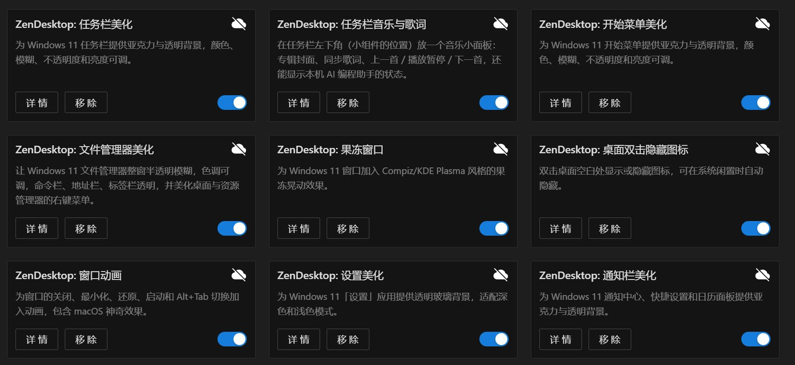
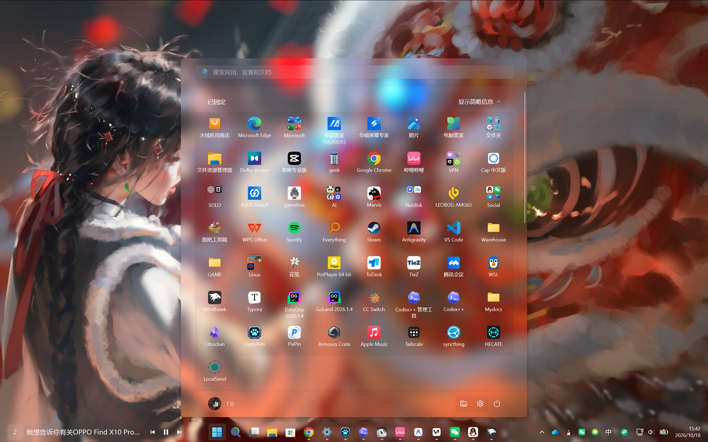
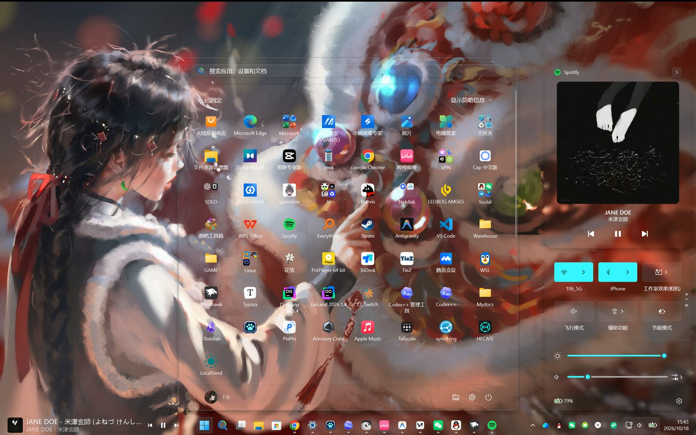
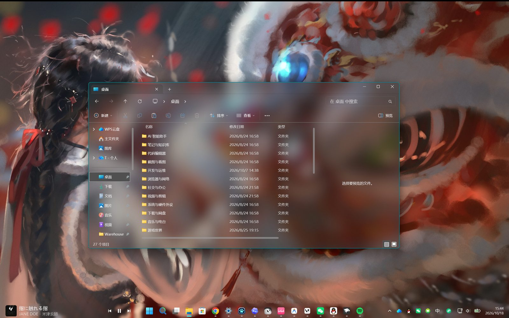
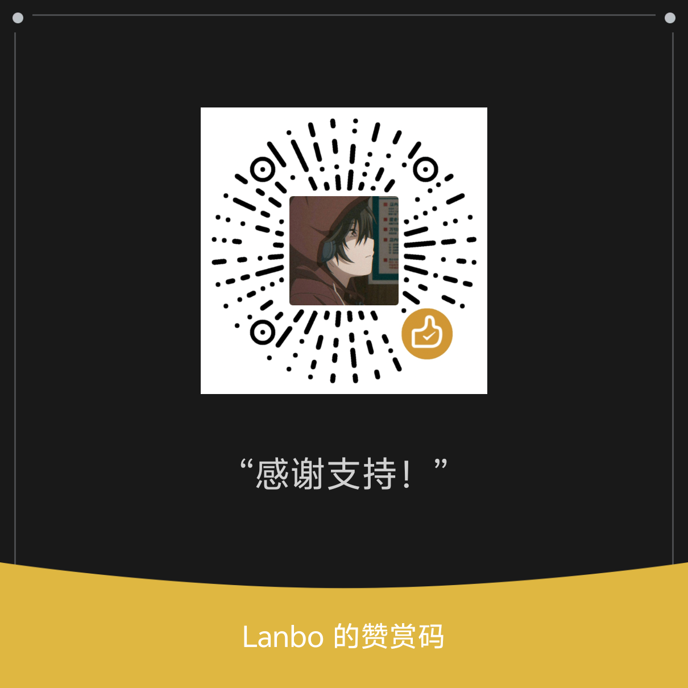

> **作者：Lanbo**
> [B站](https://space.bilibili.com/1280632999) · [抖音](https://v.douyin.com/Isl7QPpKZZ4/) · [爱发电](https://ifdian.net/a/Lanboo) · [微信赞赏](https://raw.githubusercontent.com/Liset999/ZenDesktop/main/docs/donate-wechat.png)

# ZenDesktop 🪟✨

ZenDesktop 是一套 Windows 11 桌面美化 mod，运行在 [Windhawk](https://windhawk.net) 上：任务栏、开始菜单、通知栏、「设置」和文件管理器统一换成透明玻璃风格，任务栏左下角还能显示歌词和 AI 编程助手的工作状态。一共 9 个 mod，一键部署，所有效果都在 Windhawk 的设置页里调，改完立即生效。

# 效果预览

https://github.com/user-attachments/assets/82f305da-e65e-453f-ac8d-ff5a9edfc242

[English](#english)

---

**Windhawk 里的 ZenDesktop 全家桶**：9 个 mod 装好后的样子。

**开始菜单美化 + 任务栏美化 + 任务栏音乐与歌词**：液态玻璃开始菜单，左下角是歌词面板。

**通知栏美化**：快速设置面板与媒体卡片（右侧），同屏还有开始菜单和歌词面板。

**文件管理器美化**：半透明模糊的资源管理器窗口，底部是任务栏和歌词面板。

---

## v5.0.0 更新亮点

完整更新日志见 [CHANGELOG_v5.0.0.md](CHANGELOG_v5.0.0.md)。

- **任务栏高度 / 图标大小**：「任务栏美化」新增「任务栏尺寸」分组，0 = 系统默认；不要同时开启 m417z 的「Taskbar height and icon size」。
- **新 mod「文件管理器美化」**：取代 ExplorerBlurMica，整窗半透明模糊，色调、不透明度、文字颜色都能在 Windhawk 里调，还能给右键菜单换上玻璃（测试中）。
- **新 mod「任务栏音乐与歌词」**：占用小组件的位置，显示封面、滚动歌词和播放按钮，支持 Spotify、网易云音乐、QQ 音乐等播放器。
- **AI 工作状态**：歌词面板可以显示 Claude Code、Codex、opencode、Antigravity、DeepSeek Harness 正在做什么，附带编译好的 `zen-status.exe`。
- **可选 mod**：果冻窗口、窗口动画（含 macOS 神奇效果等）、桌面时钟。
- **浅色模式**：通知栏和「设置」加了白底并加深文字；开始菜单去掉了液态玻璃的白雾，修好了应用名称不显示。
- **更像原生**：液态玻璃全部去掉额外描边，圆角与 Windows 一致；「设置」窗口失去焦点也保持透明。
- **任务栏设置分区**：新增「统一设置」（默认打开），托盘和音量浮窗跟着任务栏一起调。
- **一键卸载** `uninstall.bat`；部署脚本中英双语，不覆盖你已有的设置和开关；改用 GPL-3.0 许可证。

---

## Mod 介绍

7 个核心 mod 加可选 mod（果冻窗口、窗口动画、桌面时钟）。**部署后全部默认关闭**，在 Windhawk「已安装的 Mod」里想用哪个开哪个。核心美化 mod 的「文字颜色」用同一套选项（主题默认、白色、深色、跟随系统和几种彩色），搭配起来风格一致。

### ZenDesktop: 任务栏美化

给 Windows 11 任务栏换上亚克力、模糊或透明背景，颜色、模糊、不透明度和亮度都可调。

- 默认主题「自定义玻璃」，可切换「液态玻璃」及 30 多款社区主题（Dock 风格、Windows 7、Sun Valley 等）。
- Win+X 菜单、托盘溢出面板、音量/亮度浮窗一起换成玻璃，没有额外描边，圆角与系统一致。
- 设置按区分组；「统一设置」默认打开，弹窗跟随任务栏背景，关掉可单独调。
- 可选「最大化时加深背景」：有窗口最大化时，那块屏幕的任务栏自动换成更实的背景。
- 可选任务栏空白处点击穿透，适合 Dock 风格主题。
- 核心 mod。基于 m417z 的 Windows 11 Taskbar Styler（GPL-3.0）；「任务栏尺寸」移植自 m417z 的 Taskbar height and icon size v1.3.10（GPL-3.0）。

### ZenDesktop: 任务栏音乐与歌词

关掉小组件后，在任务栏左下角放一个音乐小面板：专辑封面、同步歌词和播放按钮。

- 支持 Spotify、网易云音乐、QQ 音乐等播放器。
- 歌词来源：网易云音乐、QQ 音乐、LRCLIB；第二行可显示翻译或「歌名 - 歌手」。
- 上一首／播放暂停／下一首，点封面或文字可切到播放器；歌词默认提前 200 毫秒，可在设置里调偏移。
- 面板嵌在任务栏里，跟着任务栏移动和自动隐藏，打开新程序时不会闪；没放歌时显示「未在播放」。
- 可显示 AI 编程助手状态，见下方「AI 工作状态」。
- 核心 mod。ZenDesktop 原创。使用前请在「设置 → 个性化 → 任务栏」里关掉小组件。

### ZenDesktop: 开始菜单美化

给 Windows 11 开始菜单和搜索页换上亚克力与透明背景。

- 默认主题「自定义玻璃」，另有三款液态玻璃主题和多款社区主题。
- 颜色、模糊、不透明度、亮度可调；展开的文件夹面板可以单独设置。
- 可自定义开始菜单宽度和高度；应用名称可设为一直显示、隐藏或悬停显示。
- 搜索页和开始菜单用同一套玻璃和文字颜色。
- 浅色模式下液态玻璃不再发白，应用名称正常显示。
- 核心 mod。基于 m417z 的 Windows 11 Start Menu Styler（GPL-3.0）。

### ZenDesktop: 文件管理器美化

让文件管理器整窗半透明模糊，命令栏、地址栏、标签栏透明，并美化右键菜单。

- 默认主题「ZenDesktop 半透明」，另有「仅透明」主题和原版的社区主题。
- 色调可从 11 种预设里选，也可以自定义颜色；色调浓度、地址栏和搜索框底色可调。
- 适配浅色模式；改完设置，已打开的窗口立即刷新。
- 桌面和文件管理器的新版右键菜单可换成可调磨砂程度的玻璃（默认开启，仍在测试）。
- 取代 ExplorerBlurMica，**不要两个同时用**。
- 也不要同时开启上游「Windows 11 File Explorer Styler」：两者争用 XAML 诊断，会反复弹出 “trying to use XAML diagnostics” 提示；在 Windhawk 里关掉上游即可（deploy.ps1 检测到会提示）。
- 核心 mod。基于 m417z 的 Windows 11 File Explorer Styler（GPL-3.0）。

### ZenDesktop: 果冻窗口

拖动、缩放或贴靠窗口时，窗口像果冻一样弹性晃动，效果仿照 Compiz 和 KDE Plasma。

- 5 档弹性预设，从最轻到最强。
- 也可以自定义刚度、速度保持和变形幅度。
- 拖动、调整大小、贴靠和最大化都有弹性过渡。
- 需要注入 `dwm.exe`，deploy 已自动加进 Windhawk 的进程包含列表；第一次打开后要重启电脑。
- **可选 mod**，默认关闭。原作者 lalimatyus（Wobbly Windows，GPL-3.0），本版只做了中文化。

### ZenDesktop: 桌面双击隐藏图标

双击桌面空白处显示或隐藏图标，也可以在电脑闲置时自动隐藏。

- 双击空白处切换；双击文件、文件夹、快捷方式照常打开。
- 闲置自动隐藏默认开启，5 秒没有键盘鼠标操作就隐藏（3–60 秒可调，也可关掉）。
- 自动隐藏后动一下鼠标或键盘就恢复；手动隐藏的不会被自动恢复。
- 不打乱图标排列，资源管理器重启或换显示器后自动重新接上。
- 核心 mod。ZenDesktop 原创。

### ZenDesktop: 窗口动画

给窗口的关闭、最小化、还原、启动和 Alt+Tab 切换加入动画，包含 macOS 神奇效果。

- 11 种关闭动画：方块碎裂、灭霸响指、柏林溶解、赛博故障、复古电视等。
- 12 种最小化／还原／启动动画：macOS 神奇效果、Windows 10、墨水飞溅、弹性弹出等。
- 每组可单独开关、选样式和时长，也可以每次随机。
- 可按进程名排除指定程序，常见游戏和反作弊程序已默认排除。
- **可选 mod**，默认关闭。原作者 ReDrag（Windows Animations，MIT），macOS 神奇效果来自 Abdullah Masood 的 macOS Minimize Animation。以前装过独立的「macOS 神奇效果最小化动画」请关掉，否则会播两次。

### ZenDesktop: 桌面时钟

在桌面图标**后方**显示大号时间和日期，不挡图标、不吃鼠标。

- 17 种样式预设 + 自定义：
  - **倾斜阴影**：白色大字、约 -8° 倾斜、深色柔和投影
  - **极简**：细体大字 + 轻投影
  - **霓虹**：青色光晕
  - **翻页**：时、分画在深色翻页卡片上
  - **大字封面**：超大极细时间，上方一行小号加字距日期（杂志风）
  - **竖排**：小时在上、分钟在下
  - **描边空心**：只留白色描边，字心透明
  - **玻璃卡片**：时钟后面一块半透明圆角卡片
  - **复古数码管**：窄体红色数字 + 暗淡的 88:88 底影 + 光晕
  - **彩虹渐变** / **日落渐变**：线性渐变填充文字
  - **中文大写**：十一时二十一分 / 十月廿八 星期三（楷体，没有则 华文楷体 / 微软雅黑）
  - **文字时钟**：「现在是 上午 11 点 21 分」
  - **圆形表盘**：指针表盘（刻度 + 时针分针，开「显示秒」才有秒针并每秒重绘）
  - **进度环**：时间外一圈圆环，按本小时已过分钟填充
  - **左侧细线**：左边一条强调色竖线 + 带星期的日期
  - **双色错位**：青/品红两层错位重影，故障复古风
  - **自定义**：用「高级」里的细调（版式、字体、旋转、投影、光晕、描边、渐变、空心字、玻璃卡片、左侧竖线等）
- **资源占用**（可选）：CPU / 内存占用，每 2 秒刷新、只在开启时采样；进度环/圆形表盘下显示为两个小圆环，其他样式为一行小字。
- **月历**（可选）：时钟右侧或下方，今天用强调色高亮，可显示农历（内置 1999–2099 农历表，不联网，不含节假日）。
- **设置精简**：顶层只有 样式、位置、微调偏移、大小、颜色、强调色、24 小时、显示秒、日期格式、显示资源占用、显示日历、日历显示农历、显示器；字体/旋转/投影/光晕/描边/渐变/版式等细调都在折叠的「高级（仅「自定义」样式生效）」里。
- 按显示器 DPI 缩放；只在分钟（或秒 / 资源占用的 2 秒）变化时重绘；资源管理器重启后自动恢复。
- **可选 mod**（`local@zen-desktop-clock`），deploy 默认关闭。桌面宿主与渲染框架改编自 m417z 的 Desktop Live Overlay（GPL-3.0）。

### ZenDesktop: 设置美化

给 Windows 11「设置」应用换上整窗透明玻璃背景，深色和浅色模式都适配。

- 整窗同一层玻璃，侧栏和内容区没有色差。
- 主题推荐「自定义玻璃」或「液态玻璃」，也保留了原版布局主题。
- 窗口失去焦点时保持透明，不会变成纯色。
- 浅色模式可加一层白底（默认 20%，可调到 10%–75% 或关闭），侧栏和标题文字更清楚。
- 背景颜色、模糊、不透明度、亮度可调。
- 核心 mod。基于 m417z 的 Windows 11 Settings Styler（GPL-3.0）。

### ZenDesktop: 通知栏美化

给通知中心、快捷设置（Win+A）和日历面板换上亚克力与透明背景。

- 默认主题「自定义玻璃」，另有液态玻璃和原版的经典主题。
- 颜色、模糊、不透明度、亮度预设可调。
- 浅色模式自动加白底并加深文字，花哨壁纸上也看得清；「对比度增强」有轻、标准、强三档。
- 支持 24H2 起快捷设置换到 `ShellHost.exe` 的新系统。
- 核心 mod。基于 m417z 的 Windows 11 Notification Center Styler（GPL-3.0）。

---

## 下载

到 [Releases](https://github.com/Liset999/ZenDesktop/releases) 下载，**三个压缩包选一个**：

| 文件 | 适合谁 |
|---|---|
| `ZenDesktop_OneKeyDeploy_v5.0.0.zip` | **大多数人选这个**。内含 Windhawk 联网安装器和全部 mod |
| `ZenDesktop_OneKeyDeploy_v5.0.0_Offline.zip` | 网络差、Windhawk 总装不上的人。内含离线版 Windhawk 安装器，体积较大 |
| `ZenDesktop_OneKeyDeploy_v5.0.0_Online.zip` | **已经装好 Windhawk** 的人。只含 mod 和脚本，最小 |

## 安装

需要 Windows 11 和管理员权限。

1. 把压缩包**完整解压**到任意文件夹（路径有空格或中文都可以），不要在压缩软件里直接运行。
2. 双击 **`deploy.bat`**，在权限提示里点「是」。没装 Windhawk 时，完整包和离线包会先打开包内的安装程序，装完自动继续；`_Online` 包请先从 [windhawk.net](https://windhawk.net) 装好 Windhawk。
3. 窗口显示「一键部署完成」后按任意键关闭。
4. 打开 Windhawk →「已安装的 Mod」，以 `ZenDesktop:` 开头的 mod **默认都是关闭的**。点进想用的 mod 打开开关，提示编译时按提示编译，几秒就好。
5. 在每个 mod 的「设置」页调效果，保存后立即生效。全部调好后建议重启一次电脑。

再次运行 `deploy.bat`（比如更新到新版本）是安全的：已打开的 mod 保持打开，改过的设置不会被覆盖，只补上新增设置的默认值。

想在无人值守安装时直接打开可选 mod：`deploy.bat -Optional "wobbly-windows,windows-animations"`。只会打开列出的 mod，其他 mod 的开关保持原样。

## 从 v4.1 升级

1. 先双击 **`tools/uninstall-ExplorerBlurMica.bat`**，在权限提示里点「是」。它会卸载旧版 ExplorerBlurMica（EBM）并重启资源管理器。
2. 再运行 `deploy.bat`，原有设置会保留。
3. 文件管理器的透明效果改由「文件管理器美化」负责，在 Windhawk 里打开它即可。
4. 以前装过独立的「macOS 神奇效果最小化动画」的，请关掉或删除它，这个效果已并入「窗口动画」。

## AI 工作状态（可选）

「任务栏音乐与歌词」可以显示本机 AI 编程助手当前在做什么。放歌时显示在第二行，没放歌时单独显示；多个助手可以排成一行，也可以轮流显示。

- 支持 Claude Code、Codex、opencode、Antigravity、DeepSeek Harness等。
- 在 PowerShell 里运行一次 `tools\ai-status\install.ps1`，它会把脚本复制到 `%LOCALAPPDATA%\ZenDesktop\ai-status-tools\` 并打印填好路径的配置片段。它不会改你的任何配置文件，片段需要你自己粘贴。
- 包里已带编译好的 `zen-status.exe`，钩子几毫秒就跑完，不会拖慢助手。
- 各助手的具体接法见 [tools/ai-status/README.md](tools/ai-status/README.md)。
- Antigravity 第一次调用 `set_status` 会弹权限确认，请选「Always Allow／总是允许」。

## 卸载

双击 **`uninstall.bat`**，在权限提示里点「是」。它会先列出要删除的内容，确认后：

- 从 Windhawk 移除全部 ZenDesktop mod（包括两个可选 mod 和 v4.1 的「macOS 神奇效果最小化动画」）及其设置。
- 删除开机自检计划任务（如果用 `-StartupCheck` 装过）。
- 询问是否删除 `%LOCALAPPDATA%\ZenDesktop`（AI 状态文件和自检日志）。
- 询问是否重启资源管理器，让任务栏、开始菜单恢复系统样式。

**Windhawk 本身不会被卸载**，你自己装的其他 mod 也不受影响。无人值守可以用 `uninstall.bat -Yes`（保留数据文件夹），加 `-RemoveData` 连数据文件夹一起删。

还需要手动处理的两处：

1. deploy 往 Windhawk「设置 → 高级设置」的进程包含列表加了 `dwm.exe`，排除列表加了一些游戏和反作弊进程，卸载不会改动，想还原请手动删掉。
2. 接过 AI 状态的，把当时粘贴到各助手配置里的 `zen-status` 片段删掉。

只想暂时停用：在 Windhawk 里关掉对应 mod，再运行 `restart_explorer.bat`（或重启电脑）。

## 常见问题

- **打开 mod 后没效果**：先确认 mod 已编译成功（Windhawk 里没有报错），再运行 `restart_explorer.bat` 或重启电脑。
- **美化完全不透、跟系统原样一样**：先到「设置 → 个性化 → 颜色」打开「透明度效果」；笔记本别开省电。deploy 后 mod 默认关着，要在 Windhawk 里打开并确认编译成功。
- **设置 → 个性化 → 背景闪退（尤其 26H2）**：设置美化 4.2.5 起会跳过背景页壁纸面板的样式；升级后重开一次「设置」再试。仍崩的话先关 HDR / PowerToys 对照。
- **亮壁纸下音量数字看不清**：任务栏美化里关掉「统一设置」后，单独把「音量/亮度浮窗」不透明度调高；或开着统一设置时把任务栏背景不透明度调高一点。
- **托盘退出要动画**：打开可选 Mod「窗口动画」，并确认「隐藏到托盘时也播放」开着（默认开）。
- **开机后文件管理器顶部（标签栏、地址栏、命令栏）不透明**：1.6.6 起会在开机后自动补挂几次，等几秒就会变透明；还不行就在 Windhawk 里把「文件管理器美化」关掉再打开。
- **开机或资源管理器自重启后，任务栏 / 托盘溢出 / 音量浮窗变回系统原样**：4.2.8 起会监听 TaskbarCreated，并在约 2.5s / 8s / 20s 自动补挂（与文件管理器顶部同思路）。开了「统一设置」一般不必再手动重置；还不行就在 Windhawk 里把「任务栏美化」关掉再打开。
- **文件管理器不透明、命令栏发黑**：只用「文件管理器美化」，不要同时开 ExplorerBlurMica；还注册着 EBM 的，先运行 `tools/uninstall-ExplorerBlurMica.bat`。
- **开机后托盘图标不透明**：在「任务栏美化」的「高级：XAML 诊断冲突处理」里改成「阻止其他程序」。TranslucentTB 等同类软件会和美化 mod 抢 XAML 诊断，建议不要同时用。
- **歌词面板不显示或和小组件重叠**：在「设置 → 个性化 → 任务栏」里关掉小组件。
- **歌词和音乐不同步**：在「任务栏音乐与歌词」设置里调「歌词偏移（毫秒）」，正数让歌词提前，负数推后。
- **任务栏搜索页不透明、是系统自带的深色底**：4.1.10 起搜索页打开后几秒内会自动补挂；还不行就在任务管理器里结束 `SearchHost.exe`（系统会自动重启它），再打开搜索。另外确认 Windhawk 高级设置的进程排除列表里没有 `SearchHost.exe`。
- **快捷设置（Win+A）没变透明**：24H2 起它在 `ShellHost.exe` 里，确认 Windhawk 高级设置的包含列表里有它，或重新运行一次 `deploy.bat`。
- **果冻窗口没效果**：打开后需要重启电脑；确认 Windhawk 进程包含列表里有 `dwm.exe`。
- **最小化动画播了两次**：关掉独立的「macOS 神奇效果最小化动画」，只留「窗口动画」。

- **窗口动画在哪**：可选 Mod **「ZenDesktop: 窗口动画」**（`local@windows-animations`），deploy 已拷贝且**默认关**；在 Windhawk「已安装的 Mod」里打开并编译即可（含关闭/最小化/Alt+Tab 与 macOS 神奇效果）。

问题反馈：[github.com/Liset999/ZenDesktop/issues](https://github.com/Liset999/ZenDesktop/issues)

## 致谢与许可证

ZenDesktop 以 [GNU General Public License v3.0](LICENSE) 发布。

- [Windhawk](https://windhawk.net) 和任务栏、开始菜单、通知中心、设置、文件管理器的上游 Styler mod：[m417z](https://github.com/m417z)（GPL-3.0）。ZenDesktop 的修改版同样以 GPL-3.0 发布。
- 内置的社区主题由各自作者贡献，详见各 Windows 11 styling guide 仓库。
- 果冻窗口：[lalimatyus](https://github.com/lalimatyus/Wobbly-Windows)（GPL-3.0）。
- 桌面时钟：桌面宿主与渲染框架改编自 [m417z](https://github.com/m417z) 的 Desktop Live Overlay（GPL-3.0）。
- 窗口动画：[ReDrag](https://github.com/redrag2105)（MIT）；macOS 神奇效果：Abdullah Masood、Potassiumuncher。
- 玻璃画刷和控件树监听参考了 [TranslucentTB](https://github.com/TranslucentTB/TranslucentTB)。
- 歌词数据来自 LRCLIB、网易云音乐、QQ 音乐，版权归原权利人所有。

第三方署名与许可见 [optional/THIRD_PARTY_NOTICES.md](optional/THIRD_PARTY_NOTICES.md) 和 [THIRD_PARTY_NOTICES-taskbar-lyrics.md](THIRD_PARTY_NOTICES-taskbar-lyrics.md)。

## 捐助

如果 ZenDesktop 对你有帮助，可以通过 [爱发电](https://ifdian.net/a/Lanboo) 或微信赞赏支持作者 Lanbo。

---

<b>English</b>

ZenDesktop is a Windows 11 desktop styling suite of 9 [Windhawk](https://windhawk.net) mods by Lanbo. It gives the taskbar, Start menu, notification center, Settings app and File Explorer a consistent translucent glass look, and adds a taskbar music/lyrics panel that can also show AI coding agent status.

**Mods** (all installed disabled; enable the ones you want in Windhawk):

| Mod | What it does |
|---|---|
| 任务栏美化 (Taskbar) | Acrylic/blur/transparent taskbar; Custom Glass (default), Liquid Glass and 30+ community themes; Win+X menu, tray overflow and volume flyout styled too |
| 任务栏音乐与歌词 (Music & Lyrics) | Media panel in the Widgets slot: album art, synced lyrics (NetEase, QQ Music, LRCLIB), playback buttons; works with Spotify, NetEase Cloud Music, QQ Music and other players; optional AI agent status |
| 开始菜单美化 (Start menu) | Acrylic/transparent Start menu and search, custom size, separate folder panel settings |
| 文件管理器美化 (File Explorer) | Translucent Explorer with adjustable tint and transparent chrome; glass context menus (experimental). Replaces ExplorerBlurMica |
| 果冻窗口 (Wobbly Windows) | Optional. Compiz/KDE style wobbly windows (injects `dwm.exe`, reboot after enabling). By lalimatyus, GPL-3.0 |
| 桌面双击隐藏图标 (Desktop icons) | Double-click the desktop to hide/show icons; optional auto-hide when idle |
| 桌面时钟 (Desktop Clock) | Optional. Big clock + date behind desktop icons; 17 presets (tilted shadow, minimal, neon, flip cards, magazine cover, stacked, hollow, glass card, 7-segment, rainbow/sunset gradient, Chinese numerals, word clock, analog dial, progress ring, accent bar, two-tone glitch) + custom; optional CPU/memory usage and month calendar with Chinese lunar dates; short settings with an Advanced group. Host/rendering adapted from m417z's Desktop Live Overlay, GPL-3.0 |
| 窗口动画 (Window Animations) | Optional. Close/minimize/restore/launch/Alt+Tab animations incl. macOS genie. By ReDrag, MIT |
| 设置美化 (Settings) | Glass background for the Settings app; stays translucent when unfocused; light-mode white base |
| 通知栏美化 (Notification center) | Acrylic notification center, quick settings and calendar; light-mode contrast boost |

**Install:** download one zip from [Releases](https://github.com/Liset999/ZenDesktop/releases) (standard with Windhawk installer / `_Offline` / `_Online` without Windhawk), extract it, run `deploy.bat` as administrator, then enable mods in Windhawk. Re-running deploy keeps your toggles and settings.

**Upgrading from v4.1:** run `tools/uninstall-ExplorerBlurMica.bat` first, then `deploy.bat`.

**AI status:** run `tools\ai-status\install.ps1` and follow [tools/ai-status/README.md](tools/ai-status/README.md). Supports Claude Code, Codex, opencode, Antigravity and DeepSeek Harness.

**Uninstall:** run `uninstall.bat`. Windhawk itself is not removed.

**License:** [GPL-3.0](LICENSE). Most mods are modified from m417z's GPL-3.0 Windhawk styler mods. Bug reports: [Issues](https://github.com/Liset999/ZenDesktop/issues). Support: [Afdian](https://ifdian.net/a/Lanboo).

